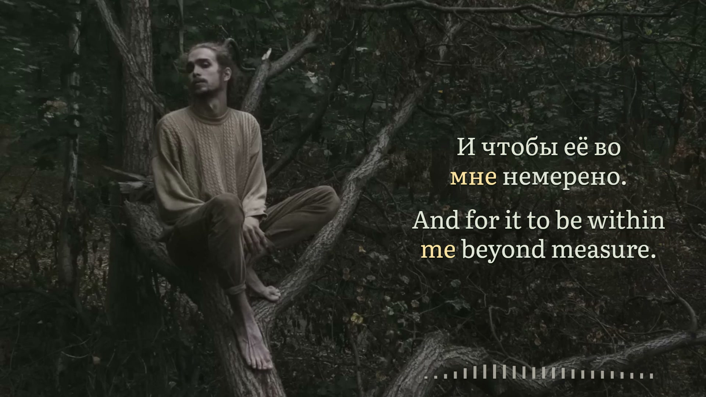

# немерено · original forest lyric film

**лампабикт feat. Элли на маковом поле · Russian / English · 16:9 and 9:16 · `nemereno-rebuild-v4.3`**



*Actual encoded frame 1,995 at 00:33.250; original source picture 831 at 00:33.240. Original recording and photograph: [the supplied upload](https://www.youtube.com/watch?v=sPw-_Of_LgQ). [Final-still provenance](evidence/final-stills.json). Separate photographer/composer credits are unverified.*

One original forest image fills each format through deliberate, undistorted framing. The complete seated figure remains clear. A compact muted-ivory spectrum supports the equal Russian and English lyrics from a fixed margin beneath them. Gentle attack, slower release and neighboring-band smoothing keep movement calm. Portrait's duet uses upper and lower reading areas around the figure.

The complete original soundtrack and picture remain present. The source photograph is static; the measured spectrum provides musical movement. A simple supporting graphic proved more suitable for this densely textured, subdued setting than an authored wooden contour or reactive picture lighting.

## Run the complete preview

Place the exact recording at `public/source.mp4` and its native reference at `public/artwork-reference.png`. Install locked Node dependencies if needed. From this project:

```sh
python3 scripts/rebuild-editorial.py
python3 scripts/build-timeline.py
npm run check
npm run verify-preview
npm run identity
PORT=4340 npm run preview
```

Open `http://127.0.0.1:4340/`. Review the complete recording, both formats, reduced speed, effects comparison and source reference. `npm run stills` produces local layout samples. Existing canonical acoustic boundaries are retained; timeline generation does not rerun recognition.

## Exact meaning, one song clock

All 267 Russian events and 338 English tokens in 46 cues have explicit meaning links. Complete grammatical expansions follow their source meaning; independent repetitions stay separate. “Немерено” preserves abundance beyond measure and the love/tree imagery. The lyric-free bridge from 104 through 120.8 seconds remains clear.

The acoustic rebuild compared bounded source/vocal Whisper observations, independent character alignment and signal panels. Sixty-four intervals changed. The owner attested full normal-speed review, uncertain words and held endings at reduced speed, and both layouts, then authorized this exact edition. Sample-indexed display precision is not a claim of perceptual sub-millisecond certainty; model disagreement remains documented.

## Verified delivery

Both H.264 films are 204.900 seconds, 60 fps, 12,294 frames, with the original AAC packets and decoded PCM unchanged. Every-frame timestamps, full strict decoding and no-black-interval checks pass. Per film, 1,114 selected source-scene comparisons and 14,952 glyph states cover all 605 Russian/English tokens. Of these, 603 have both focused and neutral lifetimes; the continuously focused backing vowel pair instead receives four clear/handoff glyph checks. All 605 deliberately delayed controls fail as expected. These checks establish encoded behavior against the approved source; listening judgment is recorded separately.

The checksum-verified 17-file upload kit contains YouTube 1920×1080, TikTok 1080×1920, a byte-identical wide Farcaster copy, dedicated covers, platform copy and optional bilingual SRTs. TikTok's profile cover is portrait 1200×1600. **`Farcaster/Caption.txt` is one complete post: title, concise AI disclosure and original-source credit.** No separate disclosure file needs merging and no platform post was made.

- [Owner review and identity](source/REVIEW.json) · [landscape checks](evidence/final-landscape-verification.json) · [portrait checks](evidence/final-portrait-verification.json)
- [Delivery inventory](evidence/upload-kit.json) · [Desktop verification](evidence/desktop-delivery.json) · [covers](evidence/cover-assets.json) · [publishing copy](evidence/publishing-copy.json)
- [Exact production and reusable lessons](PRODUCTION-NOTES.md) · [recovery procedure and agent handoff](AGENT-HANDOFF.md)

## Records and status

- [Production notes](PRODUCTION-NOTES.md): reviewed framing, restrained spectrum, translation and acoustic decisions.
- [Agent handoff](AGENT-HANDOFF.md): authoritative inputs, reproduction and recovery.
- `public/visual-contract.json`: frozen approved composition contract. Its preview-era lifecycle labels are historical; `source/REVIEW.json` and delivery receipts hold the current status.
- `evidence/preview-validation.json`: semantic, geometry, image-composition, response and subject-protection checks.

**Approved and rendered; Desktop delivery verified.** Original media, reference image, full films and acoustic diagnostics remain excluded from public source control and belong in the authenticated recovery set. Font files include their [official OFL license](https://github.com/google/fonts/blob/main/ofl/literata/OFL.txt). Public records describe reusable choices without private review quotations. Changes to the frozen composition or timeline require a new reviewed identity before another production render.
