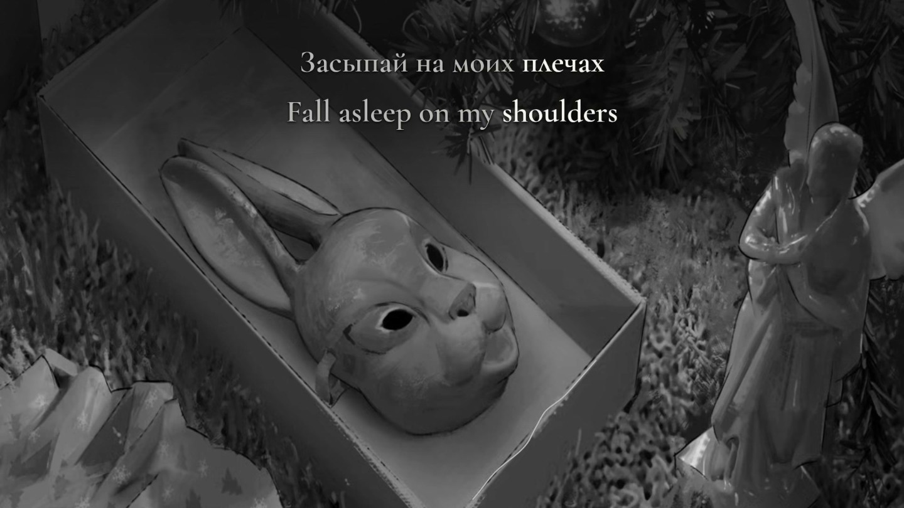

# ничего нет — bilingual lyric film

**забей, лерочка · Russian / English · approved silver v1.1 · verified 16:9 and 9:16 films**



*Decoded final YouTube frame 1,128 at 00:18.800, original picture 470; uniform documentation downscale without crop or repaint. Original picture and soundtrack: [забей, лерочка’s supplied recording](https://www.youtube.com/watch?v=ghRP43_z5N8). A separate photographer is not inferred.*

The complete 3:15 recording pairs Russian lyrics with meaning-linked English, independently selected sustained-word intervals and a quiet measured silver filament along the real gift-box rim. One source crop fills each independently composed view. Pearl-white focus and stone-grey resting words retain the monochrome winter photograph without image extension or a colored filter.

## Delivery

- YouTube: **1920×1080, 60 fps, H.264**, 35,943,224 bytes.
- TikTok: **1080×1920, 60 fps, H.264**, 38,849,563 bytes.
- Full original audio extent: **195.013 s**; film **195.016667 s**. Checked Apple AAC has zero selected offset relative to the original recording.
- Desktop kit: **17 checksum-verified files**, with both films, 3 covers, YouTube/TikTok copy, Farcaster wide copy and combined caption/disclosure, 3 subtitle options and delivery receipts.
- Every-frame timestamps and strict full decode passed; no black interval. Per format, 624 decoded scene frames, 5,076 glyph-state checks, all 307 tokens in focused/neutral states, 307 delayed controls and 121 lyric-free reading frames passed.

[Production delivery and reproduction](PRODUCTION-DELIVERY.md) · [Editorial, timing and visual process](PRODUCTION-NOTES.md) · [Agent handoff](AGENT-HANDOFF.md) · [Desktop receipt](evidence/desktop-delivery.json) · [Upload manifest](evidence/upload-kit.json) · [Verified authenticated recovery](RELEASE-BACKUP.md).

The owner explicitly accepted this current preview and commissioned production. Detailed standardized speed/layout listening fields remain unlogged in `source/REVIEW.json`; they are not inferred from acceptance or technical checks. The hash-bound owner authorization covers these unchanged inputs alone. No platform upload or public media release is performed by preparing this delivery.

## Complete preview and source recovery

Run `npm ci`, restore the exact original to `public/source.mp4`, then:

```sh
python3 scripts/prepare-source.py
npm run features
npm run check
npm run test:gate
npm run preview
```

Open `http://127.0.0.1:4342/`. The complete original source, both formats, normal/reduced speed, cue seeking and media recovery remain available. The photograph is intentionally still while native video decoding advances. Restore preview retains position, speed, layout and sound preference.

Original source: AV1 1080×1080 at 25 fps / Opus stereo, YouTube formats 399 + 251, **9,265,424 bytes**, SHA-256 `66c561c05b04ed0ca3a92af98db609ee835f84d6494a0562f0ad87261486ca4a`. Ignored media, retained analysis and final deliveries are preserved separately from compact public Git source. Historical preview screenshots remain labeled in their original manifest; the READMEs now show a decoded final-film frame.
