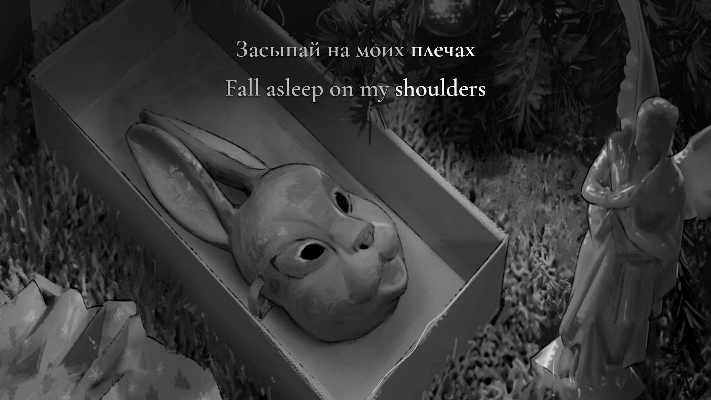

# ничего нет — bilingual lyric preview

**забей, лерочка · Russian / English · v1.1 · preview only**



*Shared-scene diagnostic at 00:18.800, not a frame from an encoded film. Original picture and soundtrack: [забей, лерочка’s supplied recording](https://www.youtube.com/watch?v=ghRP43_z5N8). No photographer identity is inferred.*

The complete 3:15 recording has equal Russian/English word focus, a monochrome silver treatment and a small measured music filament along the photographed gift-box rim. One real source crop fills each independently composed 16:9 and 9:16 view. No image extension, replacement artwork, bars, camera shake or flashing on the photographed objects.

## Review

Run `npm ci`, place the exact source in `public/source.mp4`, then:

```sh
python3 scripts/prepare-source.py
npm run features
npm run check
npm run preview
```

Open `http://127.0.0.1:4342/`. Start at zero; switch formats, seek by cue/seconds and compare normal, 0.75× and 0.5× playback. Restore preview reloads source media while retaining position, speed, format and sound preference. Source reference shows the unaltered recording with one active soundtrack.

The original AV1 1080×1080 25 fps / Opus stereo file is 9,265,424 bytes, SHA-256 `66c561c05b04ed0ca3a92af98db609ee835f84d6494a0562f0ad87261486ca4a`. Source formats were YouTube 399 + 251. The original media and regenerable analysis files are local, ignored inputs; no public media release or full film has been made.

## Status and evidence

- 39 reading cues, 129 source events and 178 English tokens.
- Original/stem recognition, independent MMS character paths and all-cue source/stem spectral inspection support timing proposals. They do not establish a complete human listening review.
- 387 boundary checks, 781 semantic states, 3,290 painted glyph states, 106 deliberately delayed controls and 26,160 exact sampled source-mask pixels passed across both layouts.
- Full current-revision listening review and production approval remain pending in `source/REVIEW.json`. Rendering is guarded before any capture or encoding.
- [Production notes](PRODUCTION-NOTES.md) · [Agent handoff](AGENT-HANDOFF.md) · [Review scope and open questions](evidence/cross-language-sync-review.md).
