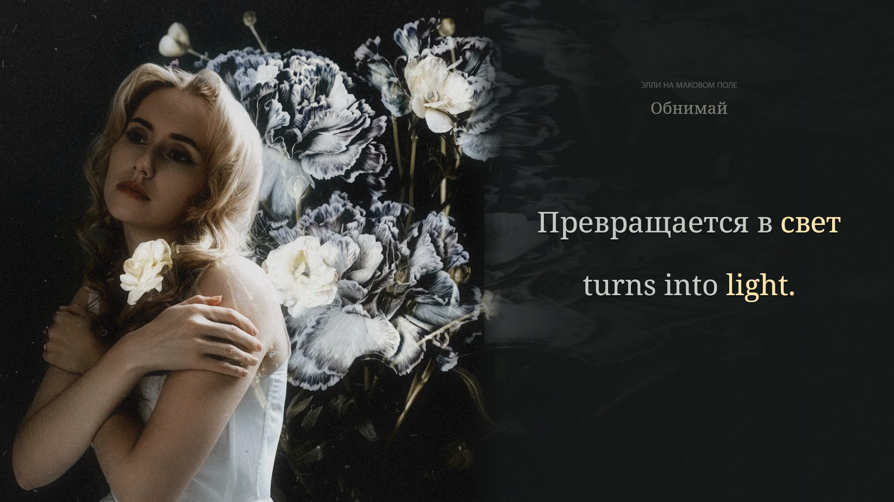

# Обнимай

**Элли на маковом поле · Russian / English · complete 16:9 and 9:16 review preview**



*Current native shared-scene preview at 00:55.430, using the original reference decoded at 00:40.000. [Capture identity and provenance](evidence/preview-stills.json). Original picture and soundtrack: [the supplied recording](https://www.youtube.com/watch?v=sCbyEiBZyEo). A still documents presentation, not acoustic accuracy.*

The original intimate photograph remains the subject. Four existing carnations host the visualizer: measured frequency energy changes light inside their real folds, while the face, embracing arms and dress remain protected. Silver light gradually warms through the refrains. The complete square stays intact in both layouts; its floral material continues into a quiet reading space. Russian and English receive equal size, weight, contrast and color-only focus.

The corrected v2 preview contains 41 cues, 144 Russian events and 165 meaning-linked English tokens, including four separately positioned **вся / all** backing candidates. Five unsupported supplied call candidates are withheld; the recording-reviewed 01:11–01:21 interval has no lyric line or focus. Three original-recording-supported calls in the later break have shorter word spans. The English refrain uses **Hold me** in the romantic sense of a sustained embrace. Each translated word follows its own Russian event, including reordered pronouns and required English grammar.

**Status: preview only.** Normal-speed full-song listening, uncertain words and held endings at reduced speed, and both-format bilingual listening review remain pending. The heavily filtered post-chorus calls and faint backing echoes are the highest-priority review areas. Their selected boundaries are provisional; additional echo ownership is not established. No production film, upload kit or public media release has been created for this song.

## Open the complete preview

The local review runs at [127.0.0.1:4338](http://127.0.0.1:4338/). It includes original audio and decoded picture, all visual layers, both layouts, speed controls, cue seeking, animation comparison, a muted original-source comparison and position-preserving recovery.

```sh
npm ci
npm run timeline
npm run identity
npm run check
npm run proof
npm run preview
```

Use Node 24. The locked source MP4 must be restored as `public/source.mp4` before identity, proof, tests or preview startup. Original media and private analysis are excluded from Git. [The recording manifest](source/recording.json) identifies the exact input; a different encoding must be checked against the timing rather than silently substituted. `npm run features` regenerates measured music data from that input using FFmpeg. With the server already running, `npm run verify:server` checks the local page, current timing, original byte ranges and private-route rejection. `npm run evidence:stills` records inspected image identities after `npm run proof`.

## Evidence and handoff

- [Agent quickstart and remaining work](AGENT-HANDOFF.md)
- [Visual brief, geometry and response](VISUAL-BRIEF.md)
- [Timing preparation, editorial decisions and limits](TIMING.md)
- [Synchronization review status](evidence/cross-language-sync-review.md)
- [Native scene and geometry checks](evidence/scene-proof.json)
- [Current browser gap image](evidence/browser-gap-still.json)
- [Browser transport observations](evidence/browser-review.json) and [local HTTP/range checks](evidence/server-check.json)
- [Coverage correction and retained/rejected candidates](source/coverage-review.json)
- [Selected source boundaries](source/selected-boundaries.json) and [competing acoustic paths](source/acoustic-observations.json)
- [Complete correspondence ledger](source/correspondence-ledger.json)
- [Intentionally still source-picture audit](source/picture-audit.json) and [diagnostic stem clock check](source/vocal-clock-check.json)

TypeScript owns timeline authoring, scene drawing, preview, identity and verification. [Native acoustic adapters](scripts/acoustic/README.md) retain small documented exceptions for PyTorch, Demucs, Whisper, torchaudio and SciPy. Passing deterministic checks does not complete actual listening. The production gate rejects missing, stale, incomplete or unauthorized review.

## Credits

Recording and original release picture: **Элли на маковом поле** and their respective creators. Supplied recording metadata identifies ONErpm, МТС Лейбл, composer/lyricist Трунова Виктория Андреевна and co-producer Элли на маковом поле. A separate photographer is not identified. Added typography, new English translation, frequency mapping and petal-light treatment belong to this project. Noto Serif is distributed under the [SIL Open Font License](public/fonts/NotoSerif-OFL.txt). Original-media distribution clearance is not established.
