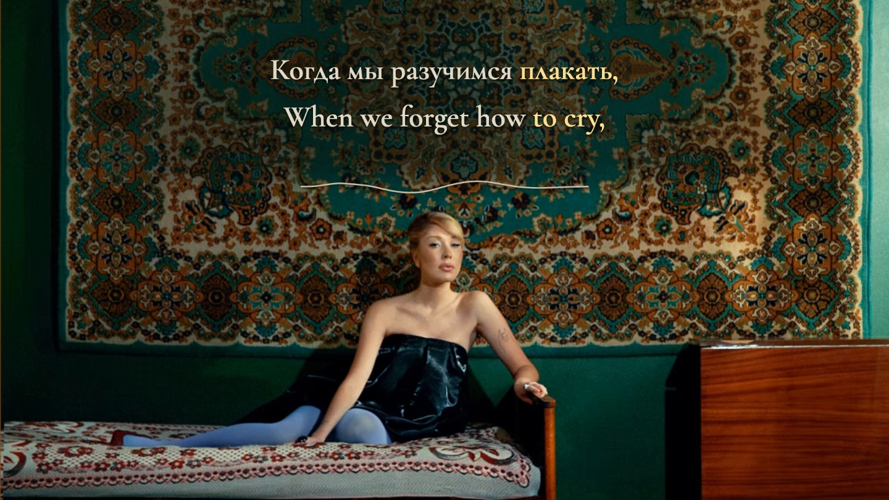

# Разучимся плакать — complete review preview

Settlers · Russian / English · 16:9 and 9:16 · **Preview only**



*Browser canvas exported at 00:33.500, resized for documentation. Original picture and recording: [Settlers’ supplied recording](https://www.youtube.com/watch?v=24oIDKiYaFs). This is a review preview, not a decoded production film. Separate photographer credit is unverified.*

The original room remains the setting. A stationary carpet reading area carries equal Semibold Russian and English text. One smooth warm-ivory music line sits below the lyrics. Twenty-four measured bands control its small bends; no replacement artwork, image extension or camera motion is added. Each format uses one uniform crop of the actual source and protects the complete seated figure.

## Open the complete preview

```sh
npm ci
python3 scripts/prepare-source.py '/path/to/exact/original.mp4'
npm run build
npm run identity
npm run preview
```

Open **http://127.0.0.1:4341/**. The complete original recording, native picture, word focus and the complete music-line response are present. Controls include seeking, cue jumps, normal/0.75/0.5 speed, both formats, effects comparison, source reference and recovery.

The original is identified in [source/recording.json](source/recording.json). It stays out of Git, along with private transcript inputs, decoded audio, model emissions and temporary stills. The font and license are included. Local preparation refuses different source bytes.

## Current state — v1.1 preview

- **29 held endings extended**, five audited endings retained, and **all 118 word starts preserved**. The original mix and vocal estimate were examined at all 34 separated held positions. [Per-occurrence reasons and evidence limits](HELD-RELEASE-REVIEW.md).
- A **single continuous line** replaces the initial pigment effect and the trial bar row. It stays fixed below the lyrics, moves gently with measured music, and remains visible at ordinary player size. The existing [rose-paper ribbon lesson](../lyubi-menya-lyubi-lyric-film/PRODUCTION-LESSONS.md#a-continuous-ribbon-can-carry-restrained-musical-motion) informs the form; its palette and dimensions are not copied.
- 26 complete reading cues, 118 independently timed Russian events and 164 English display tokens.
- Four first-half and seven second-half performances of «Насколько мне хочется жить»; broad ASR omitted several, which shorter source crops recovered.
- Supplied «весенняя зряка» corrected to **«весенняя слякоть»**. The original reference remains unchanged privately. Closing **Ну / Но** and the corrected held releases remain explicit listening-review points.
- The unchanged original soundtrack supplies all playback. Integer 48 kHz samples govern focus; the native 25 fps picture clock is separate.
- Technical display and transport checks are documented. Full normal-speed listening, uncertain-event reduced-speed review, creative acceptance and production authorization remain **pending** for this revision.
- No full film has been rendered. [The production gate](scripts/production-authorization.ts) rejects missing, incomplete or stale authorization; `npm run gate` is expected to refuse this preview.

[Production notes and exact decisions](PRODUCTION-NOTES.md) · [Agent handoff](AGENT-HANDOFF.md) · [Held-release audit](HELD-RELEASE-REVIEW.md) · [Timing selections](evidence/timing-selections.json) · [Raw model comparisons](evidence/acoustic-observations.json) · [Technical checks](evidence/technical-preview-checks.json) · [Current review identity](source/REVIEW.json)

## Local validation

```sh
npm run check
node scripts/visualizer-review.ts
npm run stills
```

`check` verifies sample boundaries, semantic unions, every rendered source/target focus state, both-layout fit, phone-side clearances, sampled exact source pixels on the protected figure and delayed-clock negative controls. The added late-body regression anchors check actual focused glyphs after their former cutoff. `visualizer-review.ts` measures on/off pixel differences at 480 px landscape and 320 px portrait; this is a visibility proxy, not listening or creative acceptance. `stills` saves shared-scene illustrations privately under `review/stills/`; it does not encode a film or establish listening review.

## Retained acoustic workflow

Use an existing analysis environment containing the package versions in `evidence/acoustic-observations.json`. The soundtrack remains the original mix; stems are private observations.

1. `scripts/prepare-source.py` verifies and decodes the original.
2. Run unprompted `scripts/acoustic/transcribe.py` on `mix`, then on `vocals` after Demucs separation/resampling. `--scope repeats` provides shorter coverage checks; `--model small --scope diagnostic` retains a correlated comparison.
3. `python3 scripts/prepare-acoustic-phrases.py` creates bounded model input from the canonical editorial map without overwriting it.
4. `scripts/acoustic/mms-observations.py --phrases analysis/phrases.json --input analysis/mix-16k.wav --output analysis/mms-mix --threads 4` retains CTC cores. `scripts/acoustic/align-whisper.py` retains the separate attention comparison, including its known failed stretched paths.
5. Keep observations separate from the selected proposals in `scripts/build-timeline.py`. After any text/event change, rebuild, validate, refresh identity and reload the complete preview. Listening review remains separate.
6. For held-release diagnostics, run `scripts/acoustic/release-review.py`, then `node scripts/acoustic/plot-release-review.ts`. The script loads and hashes the committed v1 baseline. Inspect original/stem traces before applying the separate v1.1 correction layer; plotting density and threshold candidates do not certify acoustic boundaries.
