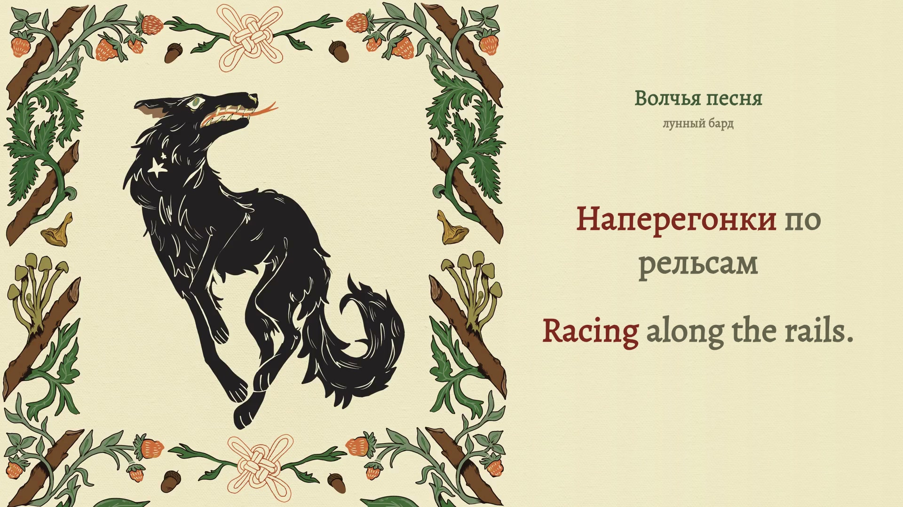

# Волчья песня

**Source channel: лунный бард · Russian / English · complete 16:9 and 9:16 films**



*Actual encoded YouTube frame 3,012 at 00:50.200, original picture 1,255 at the same source time. [Recording](https://www.youtube.com/watch?v=XSis8QjREr0) · [Exact still provenance](evidence/final-stills.json). A picture documents presentation; audio identity and listening scope are separate.*

The source illustration becomes a living printed broadside. Its wolf stays intact. Existing knotwork, leaves and berries carry measured musical changes in ink density, without a separate spectrum or moving glyphs. Warm paper extends into the reading space; equal Alegreya Russian/English words use olive neutral ink and clear rust-red focus.

The accepted v1 contains **59 cues, 228 Russian events and 306 English tokens**. Every chorus repetition has its own selected acoustic timings. The original 1080-square picture is preserved at left in landscape and above the lyrics in portrait. Both exports have 15,576 frames at 60 fps (259.600 s); the original AAC remains 259.591995 s.

## Delivery

The verified 13-file Desktop kit contains:

- YouTube 1920×1080 MP4, 1280×720 thumbnail, title and description.
- TikTok 1080×1920 MP4, 1200×1600 portrait profile cover and description.
- Optional Russian, English and bilingual SRTs; delivery manifest and checksums.

Both films pass strict full decode, all frame timestamps, identical original AAC packets and decoded PCM, and no black intervals. Per format, **1,223 selected encoded scenes and 8,591 glyph-state checks** cover every one of the 534 source/target tokens focused and neutral, including 534 deliberately delayed controls and 381 sampled reading gaps. Each scene comparison uses its actual original decoded picture. [Final verification](evidence/final-landscape-verification.json) · [Portrait verification](evidence/final-portrait-verification.json) · [Desktop copy receipt](evidence/desktop-delivery.json).

The owner accepted the complete current preview and explicitly directed rendering and delivery without another confirmation. Granular full-song/reduced-speed/layout listening fields remain unattested; no assistant direct audition is claimed. This current-song direction does not waive the shared requirements for another recording. Selected lexical and acoustic uncertainty remains explicit in [coverage](source/coverage-review.json) and [review scope](evidence/cross-language-sync-review.md).

## Reproduce the preview

Use Node 24+, FFmpeg/ffprobe and the locked native Canvas dependency. Restore the exact original MP4 as `public/source.mp4` and verify [its SHA-256](source/recording.json). Then:

```sh
npm ci
npm run check
npm run identity
npm run preview
```

The complete local preview uses port 4339. Its source-time clock, correct font, paused seeking, portrait/wide layouts, reduced-speed transport and recovery were checked in the real browser. [Unmodified native browser captures](evidence/browser-review.json) retain separate provenance from the final films.

`identity` preserves a local review only when every bound input is unchanged. It does not infer permission from published evidence. Production requires a valid current local review/authorization, `render:gate`, and an explicit `--production` flag. Existing output is never overwritten. Follow [the handoff](AGENT-HANDOFF.md) before editing selected timings or rerendering.

[Visual brief](VISUAL-BRIEF.md) · [Timing and translation](TIMING.md) · [Exact production and reusable lessons](PRODUCTION-NOTES.md) · [Shared scene-integration guide](../../docs/scene-integrated-visuals.md).

## Attribution and files

The supplied video's channel is лунный бард. Separate performer, composer and illustrator credits are not verified; none are invented. Original music, lyrics and artwork retain their creators' rights. Added English translation, typography and ornament animation use AI-assisted editorial work and code-native rendering. No generated replacement illustration was used. See [rights exclusions](../../LICENSE.md).

Public Git stores compact source, proof pictures, publishing text/covers and technical receipts. Original audio/video, raw model observations and stems are excluded. No public full-media release or YouTube/TikTok posting is represented by source integration.
